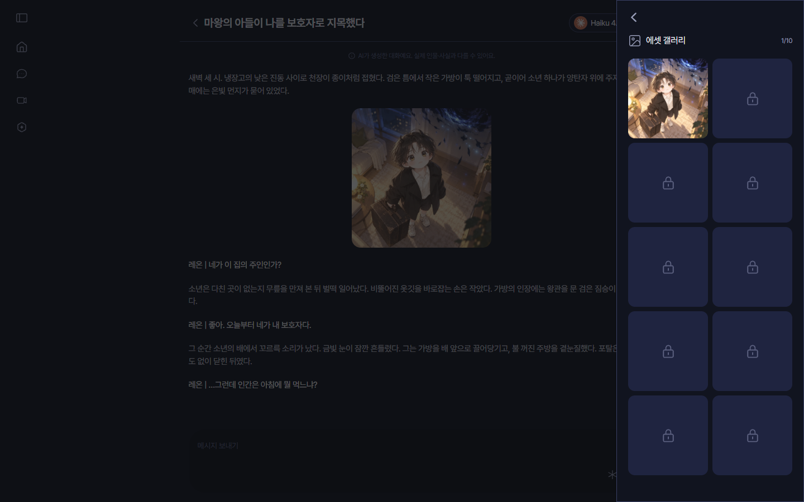

## 어디서 보나요?

대화방의 **채팅방 설정 → 메모리 로그 → 에셋 갤러리**에서 열 수 있어요. 오른쪽 위에 "1/10"처럼 지금까지 해금한 에셋 수와 이 캐릭터의 전체 에셋 수를 알려 드려요.

*에셋 갤러리예요. 해금한 에셋은 이미지로, 아직 나오지 않은 에셋은 자물쇠로 보여요.*

## 해금이 뭔가요?

이 채팅방에서 캐릭터의 답에 **한 번이라도 나온 에셋**은 해금돼서, 갤러리에서 크게 볼 수 있어요.

아직 나오지 않은 에셋은 **잠긴 에셋**으로 보여요. 잠긴 에셋은 이름과 상황도 비밀이에요. 대화를 이어 가며 하나씩 열어 보세요.

해금은 채팅방마다 따로예요. 같은 캐릭터라도 새 채팅방에서는 처음부터 다시 모아요.

## 에셋이 하나도 없어요

크리에이터가 에셋을 등록하지 않은 캐릭터라면 "아직 에셋이 없어요"라고 나와요.
